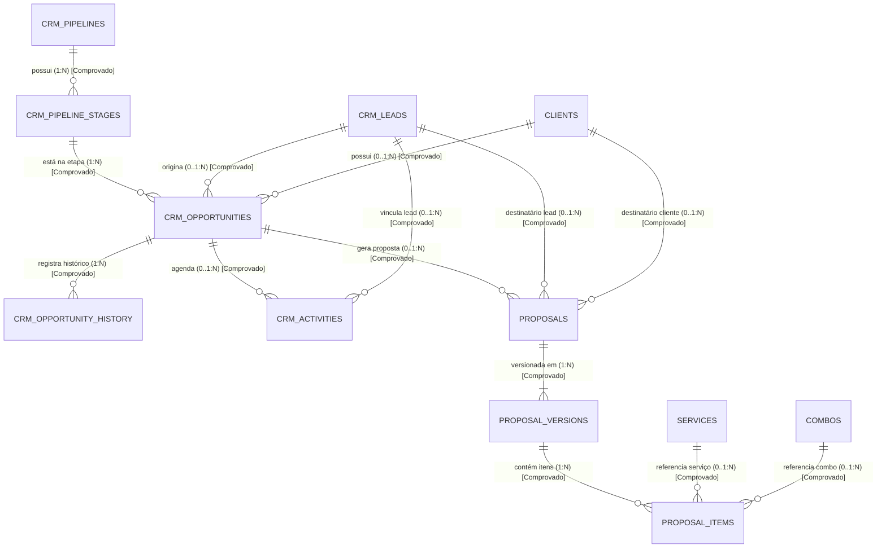
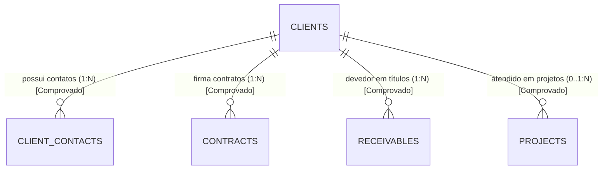
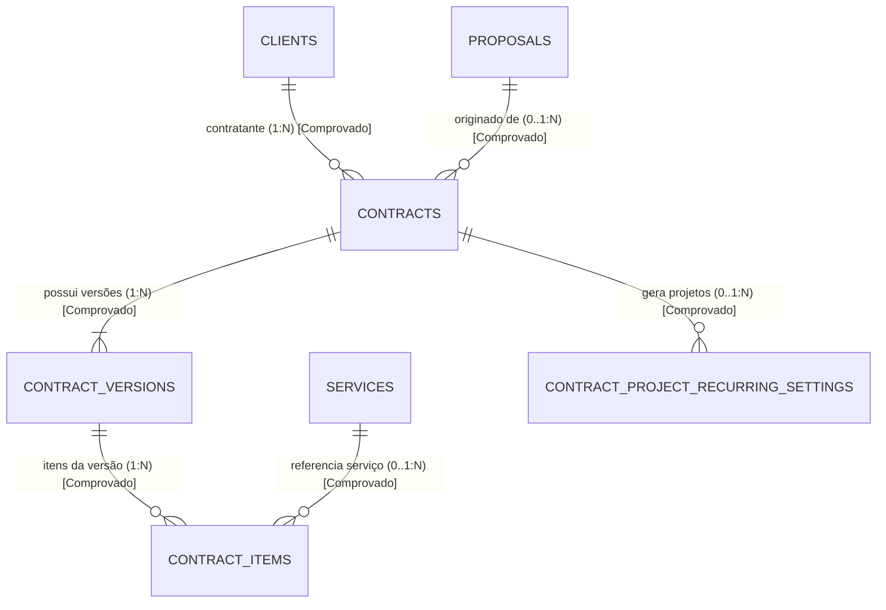
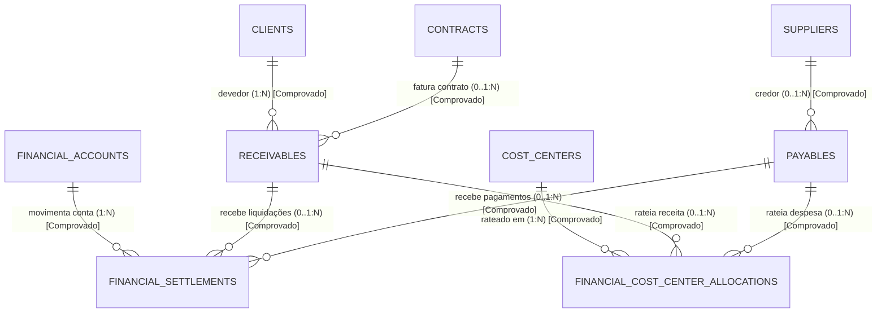
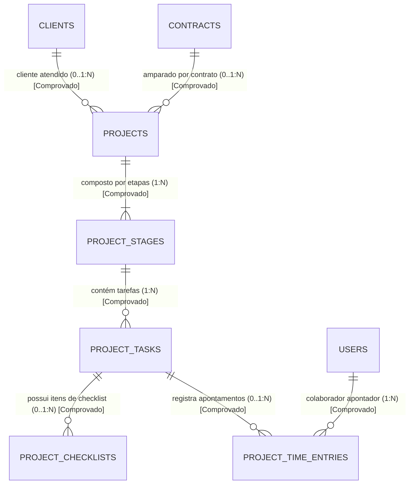
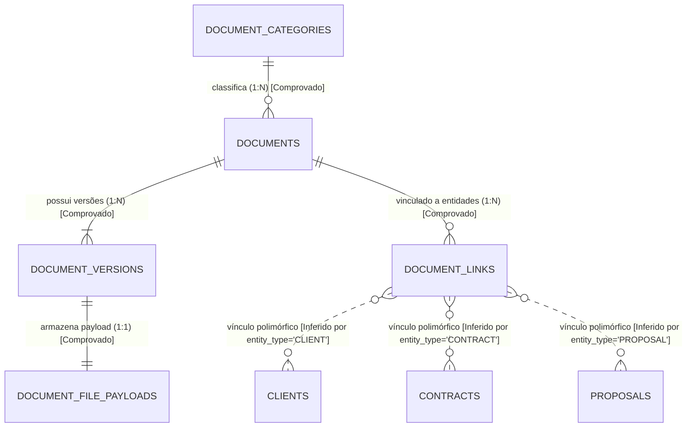

# Documentação de Modelagem de Dados — Otimizza ERP

**Data de Extração:** 01 de Novembro de 2026  
**Ambiente de Referência:** PostgreSQL 16 (Supabase) & Repositório `otimizza-pro/erp-otimizza`  
**Escopo:** 54 tabelas, 104 chaves estrangeiras físicas, 245 índices e 53 entidades de domínio ativas  
**Artefato DDL Físico:** [`otimizza_erp_physical_model.sql`](file:///c:/Users/otimi/OneDrive/Documentos/SistemaERP/database/models/otimizza_erp_physical_model.sql)

---

## 1. Visão Geral da Arquitetura de Dados

O Otimizza ERP adota uma arquitetura relacional estrita no PostgreSQL 16, projetada sob os princípios de:
1. **Idempotência Operacional:** Chaves únicas e constraints compostas impedem duplicação de lançamentos financeiros, faturamentos e conversões de propostas em contratos.
2. **Imutabilidade e Versionamento de Auditoria:** Contratos, propostas comerciais e documentos utilizam estruturas de versões (`proposal_versions`, `contract_versions`, `document_versions`) com snapshots congelados (`JSONB` e colunas numéricas), garantindo que alterações cadastrais posteriores não alterem registros históricos.
3. **Segregação Financeira em Centavos:** Todos os saldos e valores operam com números inteiros (centavos) nas regras de domínio ou com colunas `NUMERIC(15,2)` estritas no banco, sem uso de tipos de ponto flutuante (`FLOAT`/`DOUBLE`) para evitar perdas de precisão.
4. **Organização Modular:** O banco é decomposto em 6 macro-módulos integrados:
   - **Comercial & CRM**
   - **Clientes**
   - **Contratos**
   - **Financeiro**
   - **Gestão de Projetos**
   - **Gestão de Documentos**

---

## 2. Relatório de Paridade: Migrações vs. Schema do Banco

Foi executada uma análise cruzada completa entre o schema extraído do PostgreSQL 16 e os 13 arquivos de migração versionada em `database/migrations/`:

| Métrica | Schema Atual (Supabase) | Migrações Versionadas (001 a 013) | Divergência |
| :--- | :---: | :---: | :---: |
| **Total de Tabelas** | 54 (incluindo `_migrations`) | 53 de domínio + tabela de controle | **0 (100% Paridade)** |
| **Tabelas Órfãs no Banco** | Nenhuma | — | **0** |
| **Tabelas Pendentes nas Migrações**| — | Nenhuma | **0** |
| **Chaves Estrangeiras Físicas** | 104 | 104 | **0** |
| **Índices Ativos** | 245 (inclui B-Tree e GIN) | 245 | **0** |

> [!NOTE]
> **Extensões Ativas:** O banco conta com as extensões `uuid-ossp` (geração de identificadores universais) e `pg_trgm` (aceleração trigram de consultas textuais com `ILIKE` na busca global).

---

## 3. Modelo Conceitual (Entidades, Relacionamentos e Cardinalidades)

### 3.1 Convenção de Diferenciação
- **[Comprovado no Schema]:** Relacionamento garantido por `FOREIGN KEY` física no PostgreSQL.
- **[Inferido pelas Regras da Aplicação]:** Vínculo lógico garantido pela camada de serviço TypeScript, eventos ou snapshots imutáveis em JSONB (onde não há FK física propositalmente para manter imutabilidade e desacoplamento).

---

### 3.2 Módulo Comercial & CRM

#### Entidades e Atributos Relevantes:
- **Lead (`crm_leads`):** `id`, `lead_code`, `person_type`, `name`, `trade_name`, `document`, `email`, `phone`, `status`, `source`.
- **Pipeline (`crm_pipelines`):** `id`, `name`, `description`, `is_default`, `status`.
- **Etapa de Pipeline (`crm_pipeline_stages`):** `id`, `pipeline_id`, `name`, `display_order`, `win_probability`, `stage_type`.
- **Oportunidade (`crm_opportunities`):** `id`, `title`, `lead_id`, `client_id`, `pipeline_id`, `stage_id`, `estimated_amount`, `status`.
- **Histórico de Oportunidade (`crm_opportunity_history`):** `id`, `opportunity_id`, `from_stage_id`, `to_stage_id`, `notes`.
- **Atividade Comercial (`crm_activities`):** `id`, `lead_id`, `client_id`, `opportunity_id`, `activity_type`, `title`, `due_date`, `status`.
- **Proposta Comercial (`proposals`):** `id`, `proposal_code`, `title`, `client_id`, `lead_id`, `opportunity_id`, `status`, `current_version_number`.
- **Versão da Proposta (`proposal_versions`):** `id`, `proposal_id`, `version_number`, `recipient_snapshot`, `pricing_summary_snapshot`, `status`.
- **Item da Proposta (`proposal_items`):** `id`, `proposal_version_id`, `service_id`, `combo_id`, `quantity`, `unit_price`, `charge_type`.
- **Catálogo de Serviços (`services`):** `id`, `category_id`, `name`, `charge_type`, `base_price`, `status`.
- **Combos Comerciais (`combos`):** `id`, `name`, `description`, `status`.

#### Diagrama Conceitual — Comercial & CRM

---

### 3.3 Módulo de Clientes

#### Entidades e Atributos:
- **Cliente (`clients`):** `id`, `client_code`, `person_type`, `name`, `trade_name`, `document`, `status`, `email`, `phone`, `city`, `state`.
- **Contato do Cliente (`client_contacts`):** `id`, `client_id`, `name`, `email`, `phone`, `role`, `is_primary`.

#### Diagrama Conceitual — Clientes

---

### 3.4 Módulo de Contratos

#### Entidades e Atributos:
- **Contrato (`contracts`):** `id`, `contract_number`, `client_id`, `status`, `proposal_id`, `current_version_number`.
- **Versão do Contrato (`contract_versions`):** `id`, `contract_id`, `version_number`, `start_date`, `end_date`, `is_indefinite`, `total_amount`, `status`.
- **Item do Contrato (`contract_items`):** `id`, `contract_version_id`, `service_id`, `combo_id`, `item_type`, `charge_type`, `quantity`, `unit_price`, `total_price`.
- **Configuração de Projeto Recorrente (`contract_project_recurring_settings`):** `id`, `contract_id`, `template_id`, `frequency`, `day_of_month`, `status`.

#### Diagrama Conceitual — Contratos

---

### 3.5 Módulo Financeiro

#### Entidades e Atributos:
- **Conta Financeira (`financial_accounts`):** `id`, `name`, `account_type`, `initial_balance`, `current_balance`, `status`.
- **Centro de Custos (`cost_centers`):** `id`, `code`, `name`, `parent_id`, `status`.
- **Plano de Contas Gerencial (`managerial_accounts`):** `id`, `code`, `name`, `nature` (RECEITA, DESPESA_OPERACIONAL, CUSTO_SERVICO), `dre_group`.
- **Fornecedor (`suppliers`):** `id`, `name`, `trade_name`, `document`, `status`.
- **Contas a Receber (`receivables`):** `id`, `receivable_number`, `client_id`, `contract_id`, `contract_version_id`, `original_amount`, `balance_amount`, `due_date`, `status`.
- **Contas a Pagar (`payables`):** `id`, `payable_number`, `supplier_id`, `original_amount`, `balance_amount`, `due_date`, `status`.
- **Liquidação / Pagamento (`financial_settlements`):** `id`, `settlement_type` (RECEIVABLE/PAYABLE), `financial_account_id`, `amount`, `settled_at`, `is_reversal`.
- **Apropriação de Centro de Custo (`financial_cost_center_allocations`):** `id`, `receivable_id`, `payable_id`, `cost_center_id`, `percentage`, `allocated_amount`.

#### Diagrama Conceitual — Financeiro

---

### 3.6 Módulo de Gestão de Projetos

#### Entidades e Atributos:
- **Template de Projeto (`project_templates`):** `id`, `name`, `description`, `is_active`.
- **Projeto Operacional (`projects`):** `id`, `project_number`, `name`, `client_id`, `contract_id`, `status`, `start_date`, `due_date`.
- **Etapa do Projeto (`project_stages`):** `id`, `project_id`, `name`, `order_index`, `status`.
- **Tarefa do Projeto (`project_tasks`):** `id`, `stage_id`, `title`, `assignee_id`, `status`, `priority`, `due_date`.
- **Checklist (`project_checklists`):** `id`, `task_id`, `title`, `is_completed`.
- **Apontamento de Horas (`project_time_entries`):** `id`, `task_id`, `user_id`, `duration_minutes`, `cost_amount`.

#### Diagrama Conceitual — Projetos

---

### 3.7 Módulo de Gestão de Documentos

#### Entidades e Atributos:
- **Categoria de Documento (`document_categories`):** `id`, `name`, `code`, `retention_months`.
- **Documento (`documents`):** `id`, `document_code`, `title`, `category_id`, `status`.
- **Versão do Documento (`document_versions`):** `id`, `document_id`, `version_number`, `file_name`, `file_size_bytes`, `mime_type`, `sha256_hash`.
- **Carga de Arquivo (`document_file_payloads`):** `id`, `document_version_id`, `payload_base64`.
- **Vínculo Polimórfico (`document_links`):** `id`, `document_id`, `entity_type` (CLIENT, CONTRACT, PROPOSAL, PROJECT, RECEIVABLE, PAYABLE), `entity_id`.

#### Diagrama Conceitual — Documentos

---

## 4. Modelo Lógico: Tabelas e Integridade Relacional

O Modelo Lógico completo contempla as 54 tabelas com tipagem estrita no PostgreSQL:

| Tabela | Chave Primária (PK) | Chaves Estrangeiras (FK Físicas) | Índices Principais |
| :--- | :--- | :--- | :--- |
| `clients` | `id` (UUID) | — | `idx_clients_document`, `idx_clients_trgm_name`, `idx_clients_trgm_doc` |
| `client_contacts` | `id` (UUID) | `client_id -> clients(id)` | `idx_client_contacts_client_id` |
| `crm_pipelines` | `id` (UUID) | — | `idx_crm_pipelines_status`, `idx_crm_pipelines_is_default` |
| `crm_pipeline_stages` | `id` (UUID) | `pipeline_id -> crm_pipelines(id)` | `idx_crm_pipeline_stages_order` |
| `crm_leads` | `id` (UUID) | — | `idx_crm_leads_status_created`, `idx_crm_leads_document` |
| `crm_opportunities` | `id` (UUID) | `lead_id`, `client_id`, `pipeline_id`, `stage_id` | `idx_crm_opportunities_pipeline_stage` |
| `proposals` | `id` (UUID) | `client_id`, `lead_id`, `opportunity_id` | `idx_proposals_code_unique`, `idx_proposals_trgm_code` |
| `proposal_versions` | `id` (UUID) | `proposal_id -> proposals(id)` | `idx_proposal_versions_proposal_version` (UNIQUE) |
| `contracts` | `id` (UUID) | `client_id -> clients(id)`, `proposal_id` | `idx_contracts_client_id`, `idx_contracts_trgm_num` |
| `contract_versions` | `id` (UUID) | `contract_id -> contracts(id)` | `idx_contract_versions_expiring`, `idx_contract_versions_uniq` |
| `financial_accounts`| `id` (UUID) | — | `idx_financial_accounts_status` |
| `receivables` | `id` (UUID) | `client_id`, `contract_id`, `contract_version_id` | `idx_receivables_status_due_date`, `idx_receivables_trgm_num` |
| `payables` | `id` (UUID) | `supplier_id -> suppliers(id)` | `idx_payables_status_due_date`, `idx_payables_trgm_num` |
| `financial_settlements`| `id` (UUID) | `financial_account_id`, `receivable_id`, `payable_id` | `idx_settlements_account_date` |
| `projects` | `id` (UUID) | `client_id`, `contract_id` | `idx_projects_status_due_date`, `idx_projects_trgm_num` |
| `project_stages` | `id` (UUID) | `project_id -> projects(id)` | `idx_project_stages_order` |
| `project_tasks` | `id` (UUID) | `stage_id -> project_stages(id)` | `idx_project_tasks_stage_status` |
| `documents` | `id` (UUID) | `category_id -> document_categories(id)`| `idx_documents_category_status` |
| `document_versions` | `id` (UUID) | `document_id -> documents(id)` | `idx_document_versions_uniq` |
| `document_links` | `id` (UUID) | `document_id -> documents(id)` | `idx_document_links_target` (`entity_type`, `entity_id`) |

---

## 5. Mapeamento de Vínculos Inferidos vs. Comprovados

Nem todas as relações entre entidades do ERP possuem chave estrangeira física (`CONSTRAINT fk FOREIGN KEY`). Isso é uma escolha consciente de arquitetura para suportar imutabilidade e polimorfismo:

1. **Vínculo Polimórfico de Documentos (`document_links`):**
   - **Campos:** `entity_type` (`CLIENT`, `CONTRACT`, `PROPOSAL`, `PROJECT`, `RECEIVABLE`, `PAYABLE`) e `entity_id` (`UUID`).
   - **Status:** **Inferido pela Aplicação.** O PostgreSQL não suporta FK física dinâmica para múltiplas tabelas na mesma coluna. A integridade é garantida pelo serviço `src/modules/documents/service.ts`.
2. **Snapshot Imutável de Destinatário (`proposal_versions.recipient_snapshot`):**
   - **Campos:** Coluna `JSONB` armazenando `{ id, name, document, email, phone, trade_name }`.
   - **Status:** **Inferido pela Aplicação.** Garante que se o cliente ou lead for editado no futuro, a proposta histórica aprovada mantém o snapshot original do momento do envio.
3. **Auditoria Geral (`audit_logs`):**
   - **Campos:** `entity_name` (texto) e `entity_id` (UUID).
   - **Status:** **Inferido pela Aplicação.** Permite auditar qualquer registro sem criar acoplamento referencial que impeça expurgos legais ou arquivamentos.

---

## 6. Modelo Físico SQL (DDL PostgreSQL)

O Modelo Físico DDL completo correspondente ao banco real em produção está gerado e disponível no arquivo:  
📁 [`database/models/otimizza_erp_physical_model.sql`](file:///c:/Users/otimi/OneDrive/Documentos/SistemaERP/database/models/otimizza_erp_physical_model.sql)

Ele inclui:
- `CREATE EXTENSION` para `uuid-ossp` e `pg_trgm`.
- Definição das 54 tabelas com tipos, defaults, `NOT NULL` e `CHECK`.
- As 104 constraints de chave estrangeira (`REFERENCES`).
- Os 245 índices operacionais (B-Tree para ordenações e GIN Trigram para busca).

---

## 7. Informações sobre Compatibilidade com o brModelo 3.0 Desktop

### 7.1 Como funciona o brModelo 3.0 Desktop
O brModelo 3.0 Desktop clássico (desenvolvido em Java) divide os modelos em arquivos de extensão `.brM` ou `.brM3` contendo representações gráficas proprietárias (posicionamento de nós, atributos elípticos, conectores e polígonos).

### 7.2 Garantia de Não-Corrupção de Arquivos
Conforme solicitado:
- **Não foi gerado um XML genérico fictício** nem renomeado arquivos sem validação de sintaxe para evitar mensagens de erro ou corrupção ao abrir na sua instalação do brModelo.
- Assim que você fornecer o arquivo de exemplo salvo na sua versão do brModelo 3.0, seus nós e gramática serão replicados para disponibilizar o arquivo `.brM` nativo correspondente.
- Enquanto isso, os modelos estão visualizáveis de forma imediata e legível via diagramas Mermaid (nativos no Markdown), tabelas relacionais detalhadas e o DDL SQL completo.
