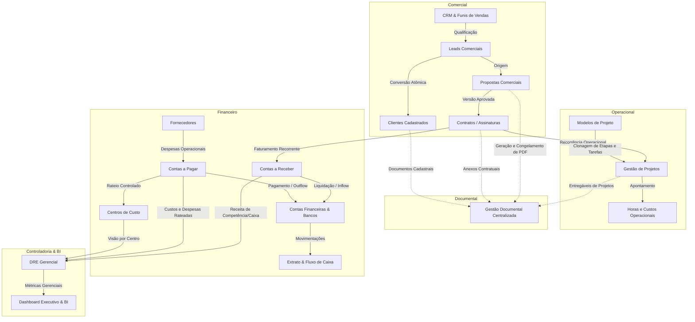
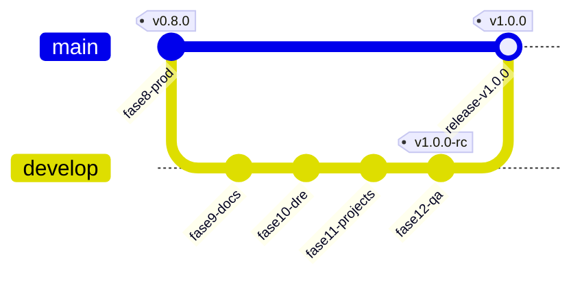

# OTIMIZZA ERP - ARQUITETURA TÉCNICA DEFINITIVA (FASES 0 A 12)

**Versão da Plataforma:** 1.0.0  
**Data:** 31 de Outubro de 2026  
**Status:** Produção e Homologação Homologadas  
**Stack Principal:** Next.js 16 (App Router + Turbopack), React 19, TypeScript 5.5, Tailwind CSS, PostgreSQL 15 / Supabase, Vitest, Vercel

---

## 1. VISÃO GERAL DA ARQUITETURA

O **Otimizza ERP** é um sistema corporativo unificado de gestão empresarial e operacional, projetado com arquitetura *single-tenant* robusta, alta disponibilidade, integridade transacional estrita e separação clara de responsabilidades.

```
+-----------------------------------------------------------------------------------+
|                                  CLIENT LAYER                                     |
|  Next.js 16 App Router (React Server Components + Client Workspaces Interativos)   |
+-----------------------------------------------------------------------------------+
                                         │  HTTPS / API Routes Server-Side
                                         ▼
+-----------------------------------------------------------------------------------+
|                             APPLICATION & API LAYER                               |
|  - Server-Side Proxy Authentication & Session Protection (Supabase Auth)          |
|  - Validação Estrita de Schemas com Zod (Valores, Tipos e Invariantes)            |
|  - Camada de Domínio / Serviços Especializados (CRM, Propostas, Projetos, etc.)   |
|  - Motor Financeiro com Aritmética Inteira em Centavos (Prevenção de Floating P.) |
|  - Conexão e Transações Isoladas (pg-pool com withTransaction)                    |
+-----------------------------------------------------------------------------------+
                                         │  PostgreSQL Protocol (SSL)
                                         ▼
+-----------------------------------------------------------------------------------+
|                             DATABASE & STORAGE LAYER                              |
|  - PostgreSQL 15 / Supabase (Migrações 001 a 012 Versionadas)                     |
|  - Row Level Security (RLS) Ativo em Todas as Tabelas de Negócio                  |
|  - Constraints de Unicidade, Chaves Estrangeiras RESTRICT/CASCADE Controladas     |
|  - Documentos Privados: Supabase Storage + Fallback Binário Resiliente no Banco   |
|  - Trilhas de Auditoria Imutáveis (audit_logs, proposal_events, document_events)  |
+-----------------------------------------------------------------------------------+
```

---

## 2. DIAGRAMA DE MÓDULOS E INTEGRAÇÕES

O ERP está estruturado em módulos coesos que compartilham entidades de forma relacional sem duplicação de dados:



---

## 3. HISTÓRICO DE MIGRAÇÕES DO BANCO DE DADOS

Todas as alterações estruturais são versionadas, idempotentes (`IF NOT EXISTS`) e possuem scripts de rollback:

| Migração | Arquivo | Escopo e Entidades Criadas |
|---|---|---|
| **001** | `001_initial_technical_schema.sql` | Estrutura técnica inicial, `_migrations`, `users`, `audit_logs`, `financial_accounts`, `financial_categories`. |
| **002** | `002_phase1_clients_services_combos.sql` | Clientes (`clients`), contatos (`client_contacts`), categorias (`service_categories`), serviços (`services`), combos (`combos`, `combo_items`). RLS. |
| **003** | `003_phase2_contracts_and_versions.sql` | Contratos (`contracts`), versionamento contratual (`contract_versions`), itens contratuais (`contract_items`), histórico. |
| **004** | `004_phase3_financial_engine_and_cashflow.sql` | Contas a receber (`receivables`), contas a pagar (`payables`), liquidações (`financial_settlements`), extrato (`financial_statements`), regras de saldo. |
| **005** | `005_phase4_analytics_and_dashboard_preferences.sql` | Preferências de BI (`user_dashboard_preferences`), metas mensais (`business_monthly_targets`). |
| **006** | `006_suppliers_and_linked_costs.sql` | Fornecedores (`suppliers`), apropriações de custo (`cost_accruals`), modelos de despesas (`payable_templates`). |
| **007** | `007_phase7_crm_and_pipelines.sql` | Leads (`crm_leads`), funis (`crm_pipelines`), etapas (`crm_pipeline_stages`), oportunidades (`crm_opportunities`), histórico de etapas, atividades (`crm_activities`). |
| **008** | `008_security_hardening.sql` | Hardening de segurança, restrição de políticas RLS em todas as tabelas, índices de desempenho e integridade. |
| **009** | `009_phase8_commercial_proposals.sql` | Propostas (`proposals`), versões (`proposal_versions`), itens cotados (`proposal_items`), eventos (`proposal_events`), conversões idempotentes (`proposal_contract_conversions`). |
| **010** | `010_phase9_document_management.sql` | Documentos (`documents`), versões (`document_versions`), armazenamento binário resiliente (`document_file_payloads`), vínculos polimórficos (`document_links`), eventos (`document_events`). |
| **011** | `011_phase10_managerial_dre.sql` | Centros de custo (`cost_centers`), rateios (`financial_cost_center_allocations`), contas gerenciais (`managerial_accounts`), apropriação de receitas (`revenue_accruals`). |
| **012** | `012_phase11_project_management.sql` | Projetos (`projects`), etapas (`project_stages`), tarefas (`project_tasks`), checklists (`project_checklists`), apontamento de horas (`project_time_entries`), modelos (`project_templates`, etapas e tarefas modelo), configurações de recorrência (`contract_project_recurring_settings`), histórico de geração (`project_generation_history`). |

---

## 4. CATÁLOGO DE APIS REST SERVER-SIDE

Todas as rotas exigem sessão administrativa autenticada e validam payloads via Zod:

### Comercial & CRM
- `GET, POST /api/crm/leads` — Listagem com filtros e cadastro de leads.
- `GET, PUT /api/crm/leads/[id]` — Detalhes e atualização de lead.
- `POST /api/crm/leads/[id]/convert` — Conversão atômica de lead em cliente ou vínculo com cliente existente.
- `GET, POST /api/crm/opportunities` — Gestão de oportunidades de vendas.
- `POST /api/crm/opportunities/[id]/move` — Movimentação de estágio no Kanban com registro de histórico.
- `POST /api/crm/opportunities/[id]/close` — Fechamento como GANHO, PERDIDO ou CANCELADO.
- `GET, POST /api/crm/pipelines` — Funis de vendas e etapas configuráveis.
- `GET, POST /api/crm/activities` — Atividades comerciais, follow-ups e agenda.
- `POST /api/crm/activities/[id]/complete` — Conclusão de atividade.

### Propostas Comerciais
- `GET, POST /api/proposals` — Listagem com paginação e criação de propostas com versão inicial.
- `GET, PUT, DELETE /api/proposals/[id]` — Consulta completa (versões, itens, eventos), edição e arquivamento.
- `POST /api/proposals/[id]/versions` — Criação de nova versão revisada com clonagem e histórico.
- `POST /api/proposals/[id]/send` — Transição para estado ENVIADO com registro de auditoria.
- `POST /api/proposals/[id]/approve` — Aprovação formal de versão específica (congelamento de valores).
- `POST /api/proposals/[id]/reject` — Rejeição de proposta com motivo obrigatório.
- `POST /api/proposals/[id]/cancel` — Cancelamento formal da negociação.
- `GET /api/proposals/[id]/pdf` — Download do documento PDF da proposta congelada.
- `POST /api/proposals/[id]/convert` — Conversão transacional e idempotente da proposta aprovada em contrato(s).

### Gestão Documental (Fase 9)
- `GET, POST /api/documents` — Busca avançada no repositório e upload autenticado multipart.
- `GET, PUT, DELETE /api/documents/[id]` — Metadados do documento, atualização e exclusão lógica.
- `GET /api/documents/[id]/download` — Download privado com validação de sessão e auditoria.
- `POST /api/documents/[id]/versions` — Upload de nova versão de arquivo com cálculo automático de hash SHA-256.
- `GET, POST /api/documents/[id]/links` — Consulta e criação de vínculos polimórficos com entidades.
- `DELETE /api/documents/[id]/links/[linkId]` — Desvinculação segura sem exclusão física do arquivo.
- `GET /api/documents/categories` — Categorias documentais ativas.

### DRE Gerencial & Centros de Custo (Fase 10)
- `GET /api/financial/dre` — Apuração da DRE por competência mensal, regime (CAIXA ou COMPETÊNCIA) e centro de custo.
- `GET /api/financial/dre/export` — Exportação da DRE em formato CSV compatível com Excel.
- `GET, POST /api/financial/cost-centers` — Gestão e ativação de centros de custo.
- `PUT, DELETE /api/financial/cost-centers/[id]` — Edição e arquivamento seguro de centros de custo históricos.
- `GET, POST /api/financial/payables/[id]/cost-center-allocations` — Rateio controlado de despesas (soma rigorosa de 100% e centavos exatos).
- `GET /api/financial/managerial-accounts` — Plano de contas gerencial para classificação de receitas e despesas.

### Gestão de Projetos & Operações (Fase 11)
- `GET, POST /api/projects` — Consulta com filtros e criação de projetos (avulsos, recorrentes ou internos).
- `GET, PUT, DELETE /api/projects/[id]` — Detalhes completos do projeto (etapas, tarefas, horas, custos), edição e arquivamento.
- `POST /api/projects/[id]/stages` — Criação de etapas no projeto.
- `POST /api/projects/[id]/tasks` — Criação de tarefas vinculadas a etapas com prazos e estimativas.
- `PUT, DELETE /api/projects/tasks/[id]` — Atualização de status da tarefa (TODO, IN_PROGRESS, IN_REVIEW, DONE) e exclusão.
- `POST /api/projects/tasks/[id]/checklists` — Adição de itens de checklist à tarefa.
- `PUT, DELETE /api/projects/checklists/[id]` — Alternância de conclusão e exclusão de checklist.
- `GET, POST /api/projects/[id]/time-entries` — Consulta e registro de apontamentos de horas e cálculo de custos operacionais.
- `GET /api/projects/templates` — Catálogo de templates de projeto padrão.
- `GET, POST /api/contracts/[id]/project-recurrence` — Consulta e configuração de automação de projetos recorrentes por contrato.
- `POST /api/contracts/[id]/generate-project` — Geração controlada e idempotente de projeto para competência de referência.

### Financeiro Tradicional & Contratos
- `GET, POST /api/contracts` — Gestão de contratos/assinaturas e versões contratuais.
- `GET, POST /api/financial/receivables` — Emissão e consulta de contas a receber.
- `POST /api/financial/receivables/[id]/settle` — Liquidação parcial ou total de recebíveis com crédito em conta financeira.
- `GET, POST /api/financial/payables` — Lançamento e consulta de contas a pagar.
- `POST /api/financial/payables/[id]/settle` — Pagamento de despesas com débito em conta financeira.
- `GET, POST /api/financial/accounts` — Contas bancárias e financeiras.
- `GET /api/financial/cashflow` — Projeção e histórico de fluxo de caixa consolidado.

---

## 5. SEGURANÇA E DEVSECOPS

1. **Sessões e Cookies:** A autenticação utiliza o Supabase Auth com tokens JWT seguros trafegados exclusivamente em cookies `HttpOnly`, `SameSite=Lax` e `Secure`.
2. **Row Level Security (RLS):** Todas as tabelas do PostgreSQL possuem RLS ativado (`ENABLE ROW LEVEL SECURITY`). Políticas estritas asseguram que requisições anônimas (`anon`) ou acessos não autorizados sejam rejeitados com HTTP 401/403.
3. **Parametrização Total contra SQL Injection:** Zero concatenação de strings em queries. Todas as chamadas ao banco utilizam placeholders posicionais `$1, $2, ...` gerenciados pelo driver nativo `pg`.
4. **Armazenamento de Arquivos Privado:**
   - Nenhum documento possui URL pública irrestrita.
   - O download ocorre exclusivamente por rota autenticada (`/api/documents/[id]/download`), validando autorização administrativa.
   - Hash SHA-256 é calculado no upload e verificado na recuperação de integridade.
5. **Aritmética Financeira Confiável:** Valores monetários são convertidos e calculados como inteiros em centavos nas funções críticas da DRE e rateios (`toCents`, `fromCents`), prevenindo discrepâncias clássicas de ponto flutuante binário (IEEE 754).

---

## 6. FLUXO DE DEPLOYMENT E AMBIENTES

O projeto adota uma esteira de integração contínua (CI/CD) segura segregando produção e homologação:



1. **Desenvolvimento Local:** Execução em `localhost:3000` conectado ao banco isolado de testes `DATABASE_URL_TEST`.
2. **Ambiente de Homologação (Staging / Vercel Preview):**
   - Branch: `develop`
   - Conectado ao projeto Supabase Staging fisicamente independente de produção.
   - Execução automática do GitHub Actions CI (`lint`, `typecheck`, `test`).
3. **Ambiente de Produção (Vercel Production):**
   - Branch: `main`
   - Migrações aplicadas somente após validação nos quality gates.
   - Zero testes destrutivos executados em produção.

---

## 7. POLÍTICA DE BACKUP E RECUPERAÇÃO DE DESASTRES

1. **Backups Diários e Point-in-Time Recovery (PITR):** O Supabase realiza backups contínuos do PostgreSQL com capacidade de restauração ponto a ponto dos últimos 7 a 30 dias.
2. **Dumps Lógicos de Segurança:** Antes da aplicação de migrações estruturais em produção, deve-se gerar dump lógico:
   ```bash
   pg_dump -h db.supabase.co -U postgres -d postgres -F c -b -v -f backup_pre_migration.dump
   ```
3. **Scripts de Rollback Idempotentes:** Cada migração versionada em `database/migrations/` possui seu respectivo script de reversão limpa em `database/rollbacks/`.
