# Roadmap de Implementação Modular do ERP

Este documento estabelece o cronograma modular, os pré-requisitos, os entregáveis e os critérios de aceitação para o desenvolvimento do Sistema ERP.

---

## Visão Geral dos Módulos

```mermaid
graph LR
    M0[Fundação Técnica & Docs] --> M1[Banco, Auth & Usuários]
    M1 --> M2[Gestão de Clientes]
    M2 --> M3[Catálogo Produtos/Serviços]
    M3 --> M4[Vendas & Contratações]
    M4 --> M5[Faturamento & Recorrências]
    M5 --> M6[Pagamentos, Títulos & Fornecedores]
    M6 --> M7[Caixa & Conciliação]
    M7 --> M8[Dashboard & Relatórios]
    M8 --> M9[Hardening & Produção]
```

---

## Detalhamento dos Módulos

### Módulo: Fundação Técnica, Arquitetura e Setup
- **Objetivo:** Estabelecer a base técnica, a infraestrutura de código, os padrões de teste, as skills de IA e toda a documentação canônica.
- **Pré-requisitos:** Ambiente Node.js e Git.
- **Entregáveis:**
  - Setup do projeto Next.js + React 19 + TypeScript Strict + Tailwind CSS.
  - Configuração do runner de testes Vitest e suíte básica de fundação.
  - Driver de banco `pg` com pool gerenciado e runner de migrações SQL versionadas.
  - Documentação completa em `docs/` e skills locais em `.agents/skills/`.
  - Endpoint de healthcheck técnico `/api/health`.
- **Critérios de Conclusão:** Quality gate executado com 100% de sucesso (`lint`, `typecheck`, `test`, `build`), sem pendências de setup.

---

### Módulo: Banco, Autenticação e Usuários
- **Objetivo:** Criar a estrutura inicial de banco de dados para segurança e gestão de usuários.
- **Pré-requisitos:** Fundação concluída; banco PostgreSQL local/remoto ativo.
- **Entregáveis:**
  - Migration inicial da tabela `users` e `audit_logs`.
  - Serviço de hash de senha seguro e autenticação baseada em cookies HttpOnly/SameSite.
  - Middleware de proteção de rotas privadas e autorização por perfil (`ADMIN`, `FINANCE`, `SALES`, `OPERATOR`).
  - Tela técnica de login e encerramento de sessão.
- **Critérios de Conclusão:** Testes de autenticação cobrindo login com credenciais válidas, rejeição de senhas incorretas, proteção de rotas restritas e auditoria de login.

---

### Módulo: Clientes (PF e PJ)
- **Objetivo:** Gestão cadastral de pessoas físicas e jurídicas.
- **Pré-requisitos:** Banco e Autenticação ativos.
- **Entregáveis:**
  - Migration da tabela `clients` com índices parciais de unicidade.
  - Validador formal de CPF e CNPJ (Módulo 11) com normalização na persistência.
  - Interface de listagem com busca rápida, paginação, filtros por status e badges de ativo/inativo.
  - Formulário unificado de cadastro e edição de PF/PJ.
  - Endpoint e Server Action de soft delete com verificação de impedimento referencial.
- **Critérios de Conclusão:** Testes unitários de validação de documentos; testes de integração para unicidade e soft delete; listagem com resposta inferior a 100ms.

---

### Módulo: Catálogo de Produtos e Serviços
- **Objetivo:** Cadastro unificado de itens negociáveis.
- **Pré-requisitos:** Banco de dados ativo.
- **Entregáveis:**
  - Migration das tabelas `services`, `service_categories`, `combos` e `combo_items`.
  - Casos de uso para criação de serviços, combos e precificação associada.
  - Interface de gestão do catálogo com filtros por tipo e status.
- **Critérios de Conclusão:** Testes garantindo que os componentes do combo somem exatamente o valor do combo e sem perdas de arredondamento.

---

### Módulo: Vendas e Contratações
- **Objetivo:** Formalização de orçamentos, vendas avulsas e contratos de fornecimento contínuo.
- **Pré-requisitos:** Clientes e Catálogo ativos.
- **Entregáveis:**
  - Migration das tabelas `contracts` e `contract_items`.
  - Lançamento de vendas com snapshot congelado de preços unitários.
  - Contratações com periodicidades `ONE_TIME`, `MONTHLY` e `YEARLY` e dia de vencimento definido.
  - Máquina de estados para ciclo de vida do contrato (`DRAFT`, `ACTIVE`, `ENDED`, `CANCELED`).
- **Critérios de Conclusão:** Testes comprovando imutabilidade: alteração de preço no catálogo não altera vendas ou contratos emitidos.

---

### Módulo: Faturamento e Geração de Recorrências
- **Objetivo:** Motor de geração de cobranças periódicas com idempotência estrita.
- **Pré-requisitos:** Contratações ativas.
- **Entregáveis:**
  - Migration da tabela `receivables` com constraint de idempotência por competência.
  - Serviço de faturamento mensal com regra de vencimento para dias 29, 30 e 31 em meses curtos.
  - Rotina idempotente de processamento de lote de faturamento.
- **Critérios de Conclusão:** Testes automatizados executando faturamento duplicado para o mesmo período confirmando bloqueio de cobrança redundante.

---

### Módulo: Pagamentos, Contas a Pagar, Contas a Receber e Fornecedores
- **Objetivo:** Gestão de títulos em aberto, fornecedores, rateios e liquidações parciais ou integrais.
- **Pré-requisitos:** Faturamento e Contas ativas.
- **Entregáveis:**
  - Migration das tabelas `suppliers`, `payables`, `payable_allocations` e liquidações financeiras.
  - Registro de liquidação com cálculo de juros, multa, desconto e saldo restante.
  - Suporte a múltiplos pagamentos parciais para o mesmo título.
  - Rotina de estorno auditável (`REVERSAL`) sem exclusão física de registros.
- **Critérios de Conclusão:** Testes unitários e de integração de baixa parcial e estorno garantindo integridade de saldos do título.

---

### Módulo: Caixa, Extrato e Conciliação Básica
- **Objetivo:** Rastreabilidade de saldos reais e movimentações entre contas.
- **Pré-requisitos:** Contas financeiras ativas.
- **Entregáveis:**
  - Tabela `financial_accounts` com atualização atômica de saldos.
  - Registro automático de créditos e débitos a partir de liquidações confirmadas.
  - Lançamento de transferências internas entre contas bancárias (débito + crédito casados).
  - Tela de extrato financeiro com cálculo de saldo dinâmico.
- **Critérios de Conclusão:** Testes garantindo que transferências não afetem categorias de resultado e que o saldo final seja matematicamente idêntico ao extrato.

---

### Módulo: Dashboard Executivo e Relatórios
- **Objetivo:** Visão analítica, indicadores gerenciais e projeção de fluxo de caixa.
- **Pré-requisitos:** Módulos operacionais ativos.
- **Entregáveis:**
  - Cards de indicadores reais: clientes ativos/inativos, faturamento realizado, títulos a vencer e saldo total em contas.
  - Gráfico de fluxo de caixa realizado (passado) versus projetado (futuro de títulos em aberto).
  - Relatório de lucratividade por serviço e fornecedor.
- **Critérios de Conclusão:** Consultas analíticas agregadas via SQL sem N+1 queries; testes de coerência entre cards e extratos.

---

### Módulo: Hardening de Segurança, Qualidade e Preparação para Produção
- **Objetivo:** Auditoria final, performance, segurança e checklist de liberação.
- **Pré-requisitos:** Todos os módulos anteriores operando.
- **Entregáveis:**
  - Suíte de testes com cobertura completa de regras de negócio.
  - Revisão de segurança OWASP (proteção CSRF, headers de segurança CSP/HSTS, rate limiting).
  - Otimização de índices e análise de planos de execução (`EXPLAIN ANALYZE`).
  - Documentação final de deploy e rotina de backup/restore do PostgreSQL.
- **Critérios de Conclusão:** 100% dos testes passando; zero vulnerabilidades críticas em auditoria; plano de contingência documentado.
